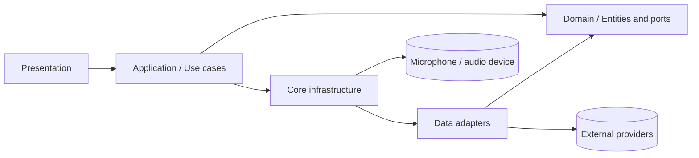
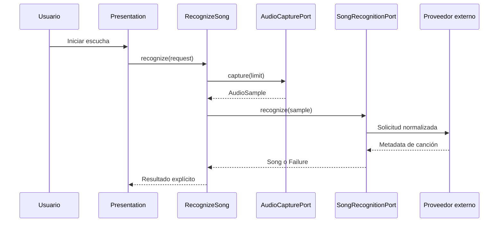

# Arquitectura objetivo

## Decisión resumida

LyricFlow usará inicialmente un **monolito modular** en Flutter, organizado
por capacidades de negocio y con una combinación pragmática de:

- **Clean Architecture** para separar presentación, aplicación, dominio e
  infraestructura.
- **Hexagonal Architecture** para definir puertos en el dominio/aplicación y
  adaptadores para APIs, micrófono, almacenamiento y reproducción.

Esto evita introducir microservicios antes de tener una frontera operativa que
lo justifique. La extracción futura de backend debe reutilizar contratos y
modelos, no copiar detalles de UI.

La raíz del proyecto contiene archivos de configuración normales de Flutter
(`pubspec.yaml`, plataformas, análisis estático y configuración del IDE). No
es necesario esconderlos en subcarpetas. La modularidad importante está dentro
de `lib/`, donde las capacidades deben quedar agrupadas por negocio.

Actualmente no existe backend ni base de datos remota: el cliente usa
`shared_preferences` para cache/historial y tiene integraciones directas o
simuladas. El inventario y la propuesta de tecnologías están en
[technology-stack.md](./technology-stack.md).

## Vista de módulos



La regla principal es que `domain` no importa paquetes de Flutter, Dio,
SharedPreferences ni clases de proveedores.

## Estructura objetivo

```text
lib/
  core/
    config/              # Configuración validada, sin lógica de negocio
    error/               # Failure, excepciones y mapeo de errores
    network/             # Cliente HTTP, políticas comunes e interceptores
    platform/            # Micrófono, permisos, filesystem y audio
    storage/             # Abstracciones y adaptadores de cache
    observability/       # Logging y métricas sin datos sensibles
    di/                  # Composición de dependencias
    widgets/             # Widgets verdaderamente compartidos
  features/
    song_recognition/
      domain/            # Song, contratos y reglas de reconocimiento
      application/       # Casos de uso y DTOs de entrada/salida
      data/              # Repositorios y adaptadores de proveedores
      presentation/      # Providers, pantallas y widgets de esta feature
    lyrics/
      domain/
      application/
      data/
      presentation/
    transcription/
      domain/
      application/
      data/
      presentation/
    practice/
      domain/
      application/
      data/
      presentation/
```

La migración puede conservar temporalmente los nombres actuales
`practice_mode` y `song_recognition`, pero los límites deben ser los de esta
estructura. No se debe mover código masivamente sin una prueba o contrato que
justifique el cambio.

## Reglas de dependencia

| Capa | Puede conocer | No puede conocer |
|---|---|---|
| Presentation | Application, modelos de presentación, Flutter | Dio, JSON de proveedores, secretos |
| Application | Domain, puertos, políticas de orquestación | Widgets, respuestas HTTP concretas |
| Domain | Entidades, value objects, puertos, reglas puras | Flutter, Dio, almacenamiento, APIs |
| Data | Domain, mapeadores, clientes y SDKs | Presentation |
| Core | Contratos técnicos compartidos | Reglas específicas de una feature |

Los repositorios concretos se implementan en `data`; las interfaces de
repositorio permanecen en `domain` o `application` según si expresan una
capacidad de negocio o una orquestación de aplicación.

## Puertos principales

```text
AudioCapturePort
SongRecognitionPort
LyricsProviderPort
TranslationPort
TranscriptionPort
StemSeparationPort
MidiExtractionPort
CachePort
```

Cada puerto debe declarar entradas, salida tipada, errores esperables,
cancelación cuando aplique y límites de tamaño/duración. Los proveedores
externos no deben filtrarse como tipos de retorno del dominio.

## Flujos críticos

### Reconocimiento



### Letras y traducción

1. Validar `songId`, título y artista.
2. Consultar cache.
3. Consultar proveedor de letras mediante `LyricsProviderPort`.
4. Normalizar letras a un modelo interno.
5. Traducir solo bajo petición del usuario.
6. Cachear con TTL y versión del proveedor.

### Trabajos pesados

Transcripción, stems y MIDI deben modelarse como trabajos con estados
`queued`, `running`, `completed`, `failed` y `cancelled`. La UI nunca debe
interpretar una respuesta demo como trabajo completado real.

## Fronteras futuras de backend

Cuando las claves, los trabajos pesados o las cuotas lo requieran, añadir:

```text
Flutter app -> Backend API -> Provider adapters
                         -> Job queue
                         -> Object storage
```

La app conservará casos de uso y modelos de negocio; cambiarán los adaptadores
de `direct provider` a `backend API`. Esta migración no debe convertir al
cliente en un contenedor de lógica de proveedores.

## Estrategia de migración

1. Congelar contratos actuales y corregir el README.
2. Extraer tipos HTTP/JSON de los casos de uso.
3. Sustituir `dynamic` por interfaces tipadas en datasources y repositorios.
4. Separar `lyrics` de `song_recognition` si sus ciclos de cambio divergen.
5. Formalizar estados de integración y eliminar fallbacks demo silenciosos.
6. Añadir pruebas de contrato para cada adaptador.
7. Mover secretos y proveedores al backend antes de publicar producción.

## Criterios de aceptación arquitectónica

- Ninguna entidad de dominio importa Flutter o un proveedor.
- Cada llamada externa tiene un puerto y un adaptador testeable.
- Un fallo de red no produce un resultado exitoso falso.
- Las pantallas dependen de casos de uso, no de Dio.
- Los límites de audio y cache están definidos y probados.
- Cada nuevo módulo tiene al menos pruebas de dominio y de aplicación.

## Documentación C4

La vista C4 completa está en [`c4/`](./c4/). El nivel de contexto explica el
sistema y sus actores, el nivel de contenedores separa Flutter, API, datos y
worker, y los niveles de componentes muestran la organización interna. Las
vistas objetivo no deben confundirse con componentes ya desplegados.
