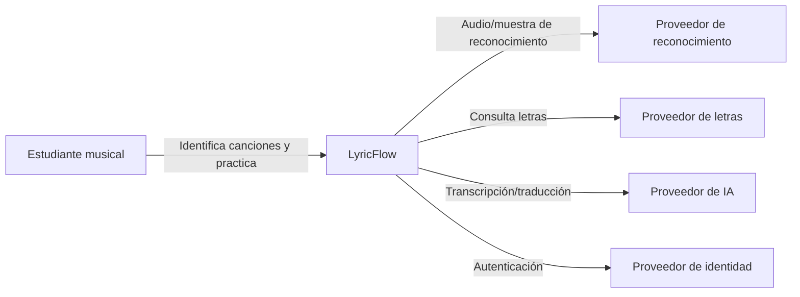
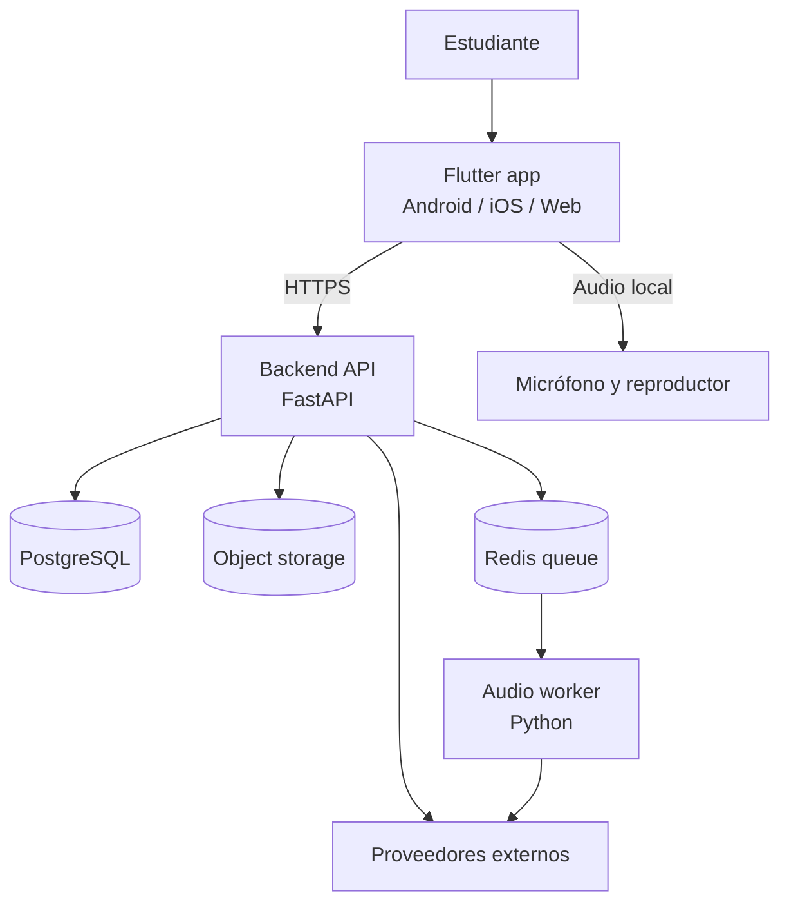
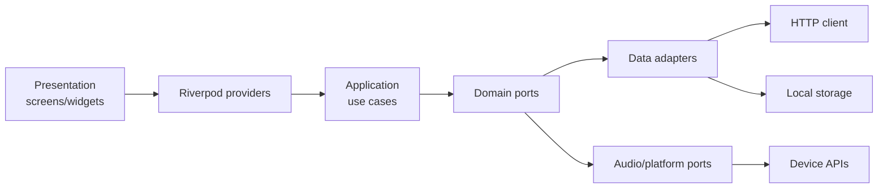
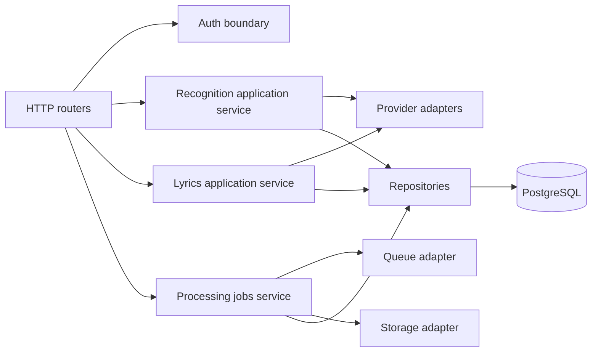
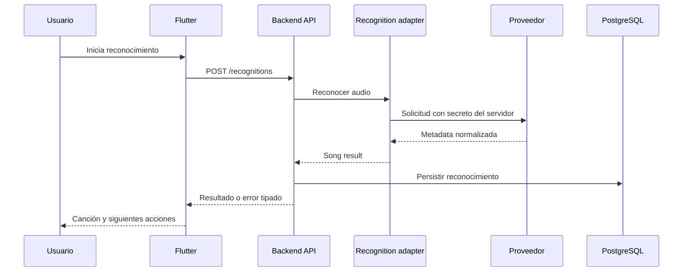

# C4 - LyricFlow

## Nivel 1: contexto del sistema



**Estado:** objetivo inmediato. Hoy las llamadas a proveedores salen del
cliente; el objetivo es moverlas detrás del backend.

## Nivel 2: contenedores



### Responsabilidad de cada contenedor

| Contenedor | Responsabilidad | Estado |
|---|---|---|
| Flutter app | UI, captura, reproducción, estado de pantalla | Actual |
| Backend API | Auth, contratos, secretos, rate limit, orquestación | Objetivo |
| PostgreSQL | Fuente de verdad de usuarios y resultados | Objetivo |
| Object storage | Audio temporal y artefactos grandes | Objetivo |
| Redis queue | Trabajos y reintentos | Objetivo |
| Audio worker | Transcripción, stems y MIDI | Objetivo |
| Proveedores | Reconocimiento, letras y modelos externos | Parcial |

## Nivel 3: componentes de la app Flutter



Componentes de negocio:

- `SongRecognition`: captura y reconocimiento.
- `Lyrics`: letras, sincronización y traducción.
- `Transcription`: trabajos de transcripción.
- `Practice`: sesiones, stems y MIDI.
- `Shared platform`: audio, permisos, cache, logging y configuración.

## Nivel 3: componentes del backend objetivo



## Nivel dinámico: reconocer una canción



## Nivel de despliegue objetivo

```text
Dispositivo
  └── Flutter app
          │ HTTPS
          ▼
     API runtime
       ├── PostgreSQL administrado
       ├── Object storage
       └── Redis
              └── Audio worker
```

El despliegue inicial puede ser un único runtime para API y un worker
independiente. El worker se separa porque sus tiempos, memoria y dependencias
de ML no deben bloquear solicitudes HTTP.

